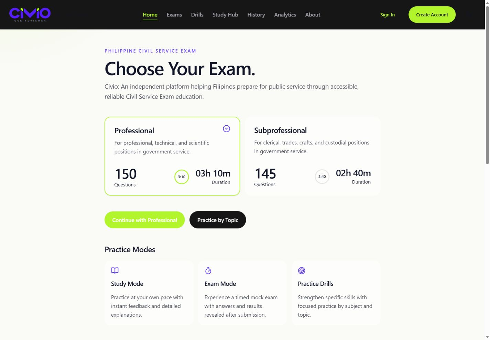
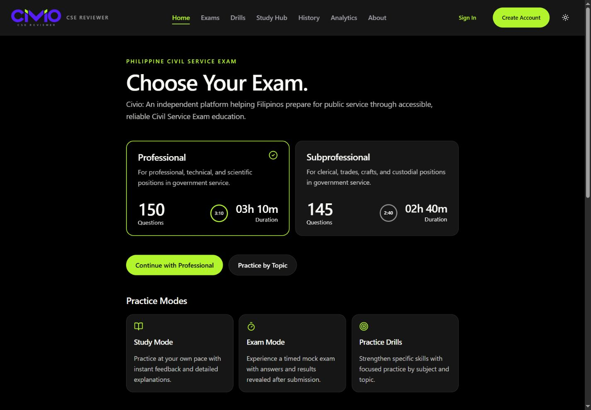
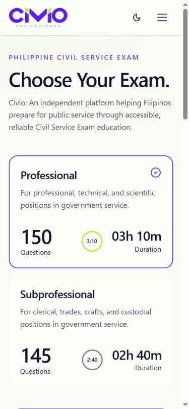
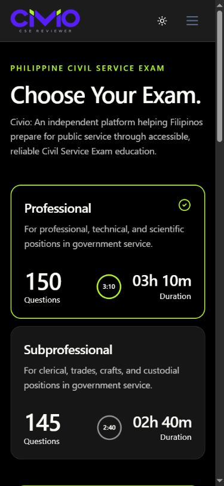

# Welcome formatting review — 18 October 2026

Source change: `cf00b8a5b7c6d5cb3a23e0ea8df94fb1d1a8c6bc` on `grok/fix-welcome-format`, based on `main` at `f2766db13827e3f6076cda66ceb7e2846c487dcb`.

The source diff only wraps the existing welcome paragraph with Prettier. No wording or application behavior changes.

## Verification actually run

Isolated PHP 8.4 / Node 22 container, SQLite in-memory tests, and an empty separate SQLite preview database on localhost:8097. No protected MSI container, study database, or Hermes access.

| Check | Result |
| --- | --- |
| `npm run types:check` | Passed |
| `npm run lint:check` | Passed |
| `npm run format:check` | Passed |
| `npm run test:js` | 94 passed |
| `php artisan test --compact` | 328 passed, 7,540 assertions |
| `npm run build` | Passed |
| `npm run size` | All budgets passed |
| `composer lint:check` | Passed |

Exact Brotli sizes from `npm run size -- --json`: entry 45,407 B / 48,000 B; vendor 119,212 / 122,000 B; CSS 28,669 / 33,000 B; exam chunk 10,205 / 11,000 B; total JS 1,037,085 / 1,040,000 B. This branch has 2,915 B of total-JS headroom. Measurements for other branches are pending.

## Real browser evidence

Captured from the running application through the browser screenshot API, without image generation or compositing. Desktop viewport requested: 1440 × 1000. Phone viewport requested: 390 × 844. The phone page reported document width 375 and viewport width 390, with no horizontal overflow.

| Desktop light | Desktop dark |
| --- | --- |
|  |  |

| Phone light | Phone dark |
| --- | --- |
|  |  |

These captures verify the welcome page only. The visible sample question is the existing unscored illustration; it is not a live exam. Exam workspace, Reveal states, Lite mode, results, and other branch screenshots remain unverified in this continuation. The temporary local capture endpoint was removed before staging.

## Review queue

The 16 existing branches now have draft PRs in GT's requested order: [PR #1](https://github.com/Vincenzo-OPC/Civio/pull/1) through [PR #16](https://github.com/Vincenzo-OPC/Civio/pull/16). Only PR #1 has this local full-suite and browser evidence. Other PRs explicitly retain their pending validation, screenshots, and owner/editorial decisions. A draft PR does not activate questions or signify approval.

GT's 18 October handoff overrides the older main-only workflow: no main pushes, merges, force-pushes, or deployments. The earlier isolated checkout and its interrupted merge/stash were preserved. No new merge was attempted in this continuation.
