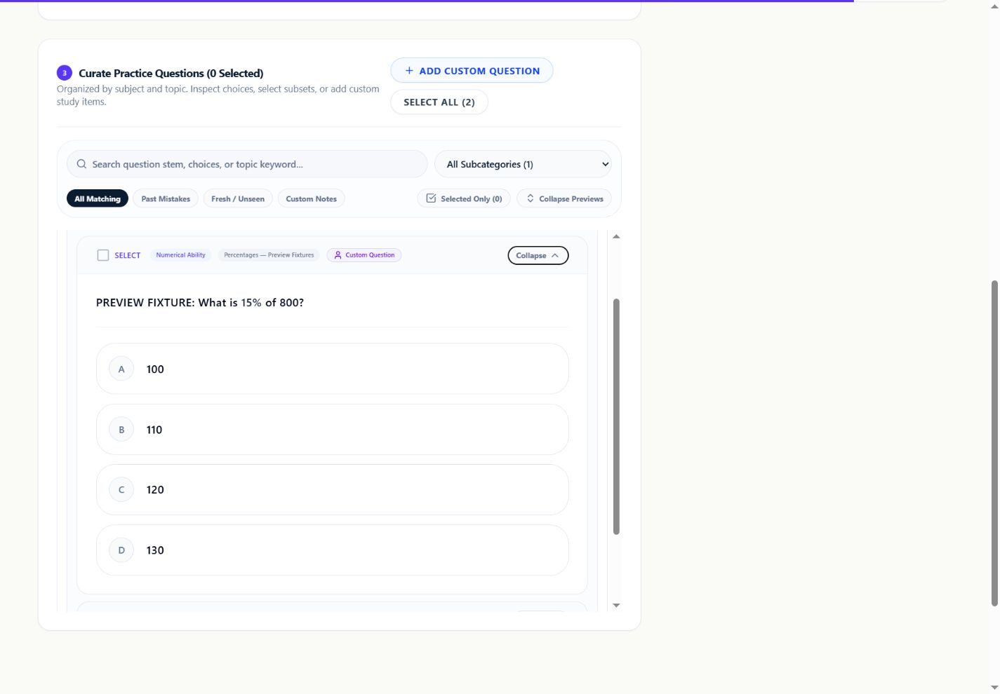
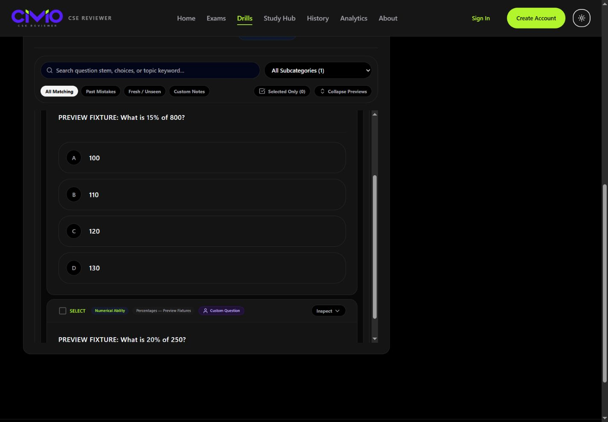
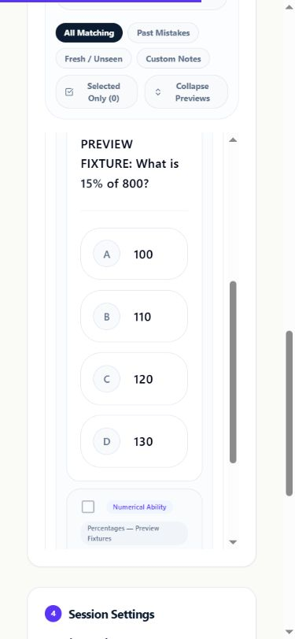
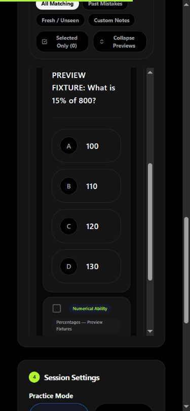

# Drill answer-key review — 19 October 2026

This is local validation for [PR #2](https://github.com/Vincenzo-OPC/Civio/pull/2), based on `9086e0f3622c326e4583c14f31b5292dc132cedd`. It is not merged or deployed. Main was last fetched at `f2766db13827e3f6076cda66ceb7e2846c487dcb`.

## Change and regression evidence

The branch withholds bank keys and explanations on the drills hub, saved-set questions and smart-weakness endpoint. Review found that its author exception still exposed active bank keys to their author, including during Strict Mock. The exception now requires both ownership and `QuestionStatus::Draft`. Creation of private custom questions still returns the owner's key.

The regression suite failed in seven cases before the fix and passes all 14 cases afterward (88 assertions). Its route matrix asserts all three expected question IDs are present and keyless for the requester-as-author, another author and no author, with and without a protected attempt. Resource tests check draft owner, other user and guest visibility; a guest hub test verifies usable stems and choices without keys.

Formatting prerequisite `a077dd7` changes only the welcome paragraph's Prettier wrapping, in its own commit. No merges were performed.

## Checks actually run

All completed in the isolated `civio-review-check` container, using SQLite in-memory for PHP tests:

| Command | Result |
| --- | --- |
| `php artisan test --compact` | 342 passed, 7,628 assertions |
| `npm run types:check` | Passed |
| `npm run lint:check` | Passed |
| `npm run format:check` | Passed |
| `npm run test:js` | 94 passed |
| `npm run build` | Passed |
| `npm run size` | Passed |
| `composer lint:check` | Passed, 422 PHP files |

Brotli sizes: entry 45,407 / 48,000 B; vendor 119,212 / 122,000 B; CSS 28,669 / 33,000 B; exam chunk 10,205 / 11,000 B; all JS 1,037,085 / 1,040,000 B. No frontend dependencies or budgets changed.

## Real browser evidence

Chrome, guest Custom Builder with an expanded question. Desktop viewport 1440 × 1000; phone viewport 390 × 844. These are actual captures of the local app, not generated mockups. The question stem and four choices remain visible without a correct-answer marker or explanation in both themes.

| Desktop light | Desktop dark |
| --- | --- |
|  |  |

| Phone light | Phone dark |
| --- | --- |
|  |  |

The fixtures are explicitly labelled PREVIEW FIXTURE and exist only in `/tmp/civio-review.sqlite` in the isolated container. No protected MSI container, study database, student record or permanent bank content was modified. Authenticated ownership and Strict Mock are tested server-side; these screenshots do not claim authenticated or Lite Mode browser verification. The legacy “Custom Question” badge follows `created_by` and can label an authored active fixture; changing that badge is outside this security slice.

## Review gate and next slice

PR #2 remains draft pending GT's choice about the custom-builder preview: bank answers are now hidden there. No separate admin answer-preview route was added. All routine security work is complete without deciding that product question.

Next: verify PR #3's nullable fact metadata and import QA against the existing bank contract; keep its unresolved mock-picking policy separate. Before adding more frontend UI, reclaim bundle headroom. The durable next learning recommendation remains an owner-scoped return-to-mistakes queue from server-graded drill results, followed by persistent review scheduling; existing FSRS utilities are not a shipped review loop.
